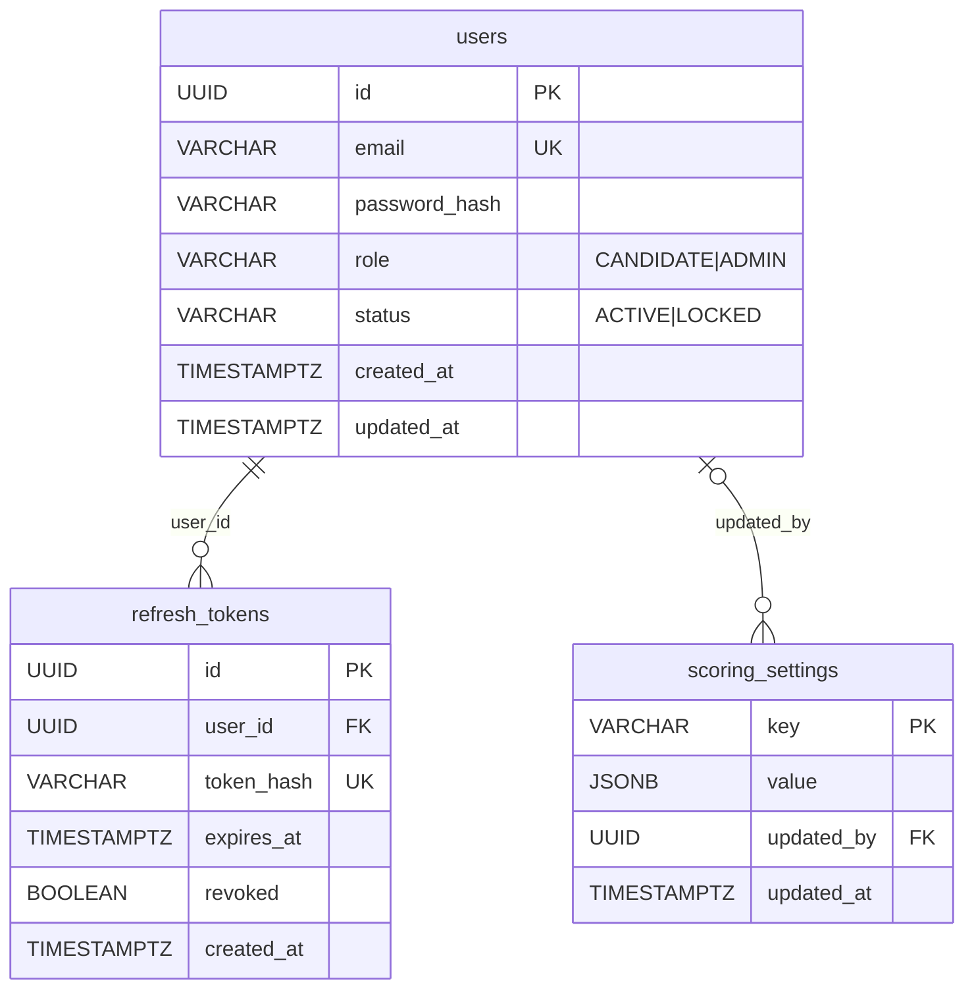
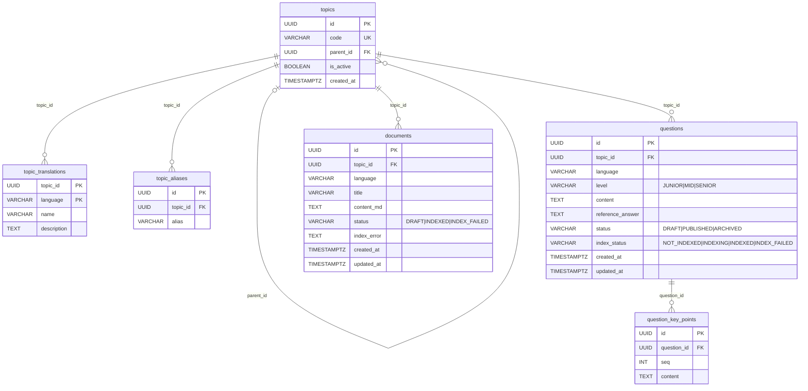
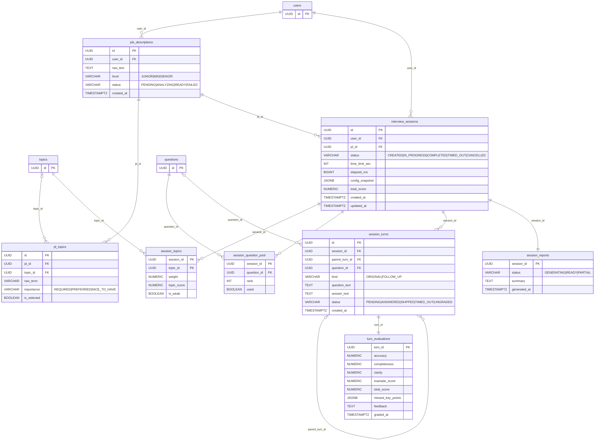
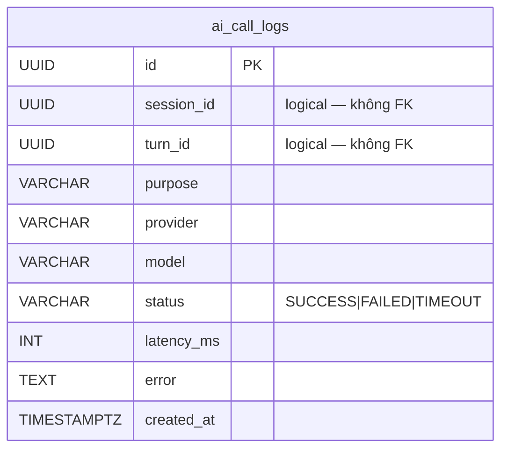
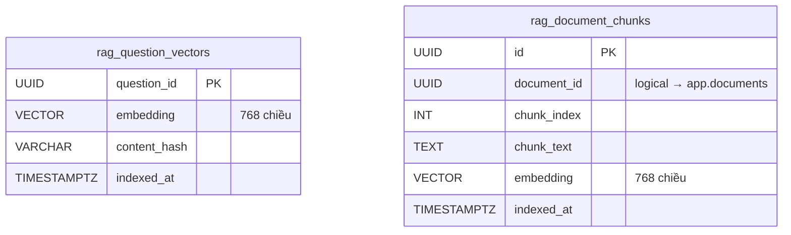

# Database Schema — ERD Diagram

> Cập nhật: 2026-10-16 · Task 02 (Database migrations)
> Nguồn gốc: SRS §10.5, §9.4 · design.md §2.1, §3.1, §4.1, §4.4, §5.1

---

## 1. Tổng quan schema

Hệ thống dùng một cơ sở dữ liệu **Neon PostgreSQL + pgvector**, chia thành **hai schema** tách biệt theo chủ sở hữu (SRS §10.5):

| Schema | Chủ sở hữu | Công cụ migration | Số bảng | Vai trò |
|---|---|---|---|---|
| `app` | Java (Spring Boot) | Flyway `V001`–`V010` | 18 | Toàn bộ trạng thái nghiệp vụ: users, nội dung, phiên phỏng vấn, điểm, log |
| `rag` | Python (FastAPI) | script `001`–`003` | 2 | Vector embedding cho RAG (câu hỏi & chunk tài liệu) |

**Nguyên tắc bất biến (SRS §10.5, design.md §4.1):**

- **Không có foreign key giữa hai schema.** Liên kết `rag ↔ app` chỉ là liên kết logic theo UUID — tránh ràng buộc vòng và giữ ranh giới sở hữu rõ ràng.
- **Java không tạo vector / không gọi LLM** — chỉ orchestrate. Python sở hữu `rag` và embedding.
- **Điểm do Java tính (BR-01)** — bảng `turn_evaluations.total_score` do Java ghi, LLM chỉ trả từng tiêu chí.
- Mọi bảng dùng `UUID` (PK) sinh bởi `gen_random_uuid()` (`uuid-ossp`); mốc thời gian dùng `TIMESTAMPTZ`.

**Phân nhóm bảng (để dễ đọc sơ đồ ER):**

| Nhóm | Bảng | Spec / module |
|---|---|---|
| Auth & Users | `users`, `refresh_tokens`, `scoring_settings` | M1 (design.md §2.1) |
| Content Management | `topics`, `topic_translations`, `topic_aliases`, `questions`, `question_key_points`, `documents` | M2 (design.md §3.1) |
| Interview | `job_descriptions`, `jd_topics`, `interview_sessions`, `session_topics`, `session_question_pool`, `session_turns`, `turn_evaluations`, `session_reports` | M5/M7 (tạo sẵn ở V007, dùng ở Spec 02/03) |
| AI Call Logs | `ai_call_logs` | NFR-24 (design.md §7) |
| RAG | `rag_question_vectors`, `rag_document_chunks` | M3 (design.md §4.1, §4.4) |

> Ghi chú về sơ đồ Mermaid dưới đây: ký hiệu `||--o{` = một-nhiều, `||--||` = một-một, `|o--o{` = không-bắt-buộc một-nhiều. Đánh dấu `PK`/`FK`/`UK` trong khối entity là chú thích; quan hệ thực được vẽ bằng đường nối. Các bảng xuất hiện ở nhiều nhóm (users, topics, questions) chỉ hiển thị khóa chính trong sơ đồ nhóm khác — xem chi tiết đầy đủ cột ở **§5** và sơ đồ nhóm sở hữu.

---

## 2. Sơ đồ ER — Schema `app`

### 2.1 Nhóm Auth & Users

- `users ||--o{ refresh_tokens`: một user có nhiều refresh token (single-use, FR-01-JWT).
- `users |o--o{ scoring_settings`: `updated_by` nullable (`ON DELETE SET NULL`) — một setting có thể không thuộc user nào sau khi user bị xóa.

### 2.2 Nhóm Content Management

- `topics |o--o{ topics`: tự tham chiếu `parent_id` (nullable) — hỗ trợ cây 1 cấp (FR-37).
- `topic_translations` & `question_key_points`: ràng buộc UNIQUE composite (`(topic_id, language)`, `(question_id, seq)`) — xem §5.
- `topic_aliases`: UNIQUE composite `(topic_id, alias)` — không vẽ UK trên từng cột vì uniqueness là theo cặp.

### 2.3 Nhóm Interview

- `session_topics` & `session_question_pool`: PK composite (đánh `PK` trên cả hai cột); bản chất FK được thể hiện qua đường nối.
- `turn_evaluations.turn_id` và `session_reports.session_id`: vừa PK vừa FK (một-một) — đường nối `||--||` thể hiện quan hệ.
- `session_turns |o--o{ session_turns`: tự tham chiếu `parent_turn_id` (nullable) cho FOLLOW_UP (BR-05).
- `users`, `topics`, `questions` ở đây chỉ vẽ `id PK` (thuộc nhóm Auth/Content — xem §2.1, §2.2, §5).

### 2.4 Nhóm AI Call Logs (độc lập)

- Bảng standalone: `session_id` và `turn_id` là **tham chiếu logic, không có FK** (log tồn tại lâu hơn turn/session, tránh ràng buộc vòng — NFR-24).

---

## 3. Sơ đồ ER — Schema `rag`

- Cả hai bảng **không có FK** tới `app` — chỉ liên kết logic qua UUID (SRS §10.5, design.md §4.1).
- `rag_document_chunks`: UNIQUE composite `(document_id, chunk_index)`.
- `VECTOR` là kiểu `pgvector` (chiều 768, configurable qua `settings.embedding_dim`).
- SRS §10.5: ở quy mô ~2.000 vector (≈6 MB) chưa cần vector index (ivfflat/hnsw) — thêm khi vượt 10K.

---

## 4. Liên kết logic giữa hai schema (không FK)

Vì không có FK xuyên schema, tính toàn vẹn tham chiếu được bảo đảm ở lớp ứng dụng (Java kiểm tra sự tồn tại trước khi Python index; Python không DELETE bản ghi `app`).

| Bảng `rag` | Khóa | Liên kết tới `app` | Ý nghĩa | SRS / design |
|---|---|---|---|---|
| `rag.rag_question_vectors` | `question_id` (PK) | `app.questions.id` | Vector embedding của câu hỏi PUBLISHED — phục vụ RAG retrieval (FR-15) | design.md §4.1 |
| `rag.rag_document_chunks` | `document_id` | `app.documents.id` | Chunk + embedding của tài liệu ôn tập — phục vụ truy xuất tài liệu (FR-33, FR-28) | design.md §4.4 |

**Cơ chế đồng bộ:** khi `questions`/`documents` đổi nội dung, Java ghi `index_status`/`status` → gọi Python re-index. Cột `content_hash` (SHA-256) trong `rag_question_vectors` phát hiện cần re-index khi nội dung thay đổi.

---

## 5. Chi tiết từng bảng

### 5.1 Nhóm Auth & Users

#### `users` — V001 · FR-01, FR-RBAC, FR-34, NFR-17, NFR-19 · design.md §2.1

| Cột | Kiểu | Khóa / ràng buộc | Ghi chú |
|---|---|---|---|
| id | UUID | PK | DEFAULT `gen_random_uuid()` |
| email | VARCHAR(254) | UNIQUE, NOT NULL | |
| password_hash | VARCHAR | NOT NULL | bcrypt, cost ≥ 12 (NFR-17) |
| role | VARCHAR(20) | NOT NULL, CHECK `CANDIDATE\|ADMIN` | NFR-19 (RBAC) |
| status | VARCHAR(20) | NOT NULL, CHECK `ACTIVE\|LOCKED` | DEFAULT `ACTIVE` — FR-34 |
| created_at | TIMESTAMPTZ | NOT NULL | DEFAULT `CURRENT_TIMESTAMP` |
| updated_at | TIMESTAMPTZ | NOT NULL | DEFAULT `CURRENT_TIMESTAMP` |

Indexes: `idx_users_email`, `idx_users_role`, `idx_users_status`.

#### `refresh_tokens` — V001 · FR-01-JWT · design.md §2.1

| Cột | Kiểu | Khóa / ràng buộc | Ghi chú |
|---|---|---|---|
| id | UUID | PK | DEFAULT `gen_random_uuid()` |
| user_id | UUID | FK → `users(id)` ON DELETE CASCADE, NOT NULL | |
| token_hash | VARCHAR | UNIQUE, NOT NULL | SHA-256 của raw token; raw chỉ gửi client 1 lần |
| expires_at | TIMESTAMPTZ | NOT NULL | |
| revoked | BOOLEAN | NOT NULL | DEFAULT `FALSE` — set TRUE khi lock user (AC-USER-01) hoặc token đã dùng (single-use) |
| created_at | TIMESTAMPTZ | NOT NULL | DEFAULT `CURRENT_TIMESTAMP` |

Indexes: `idx_refresh_tokens_user_id`, `idx_refresh_tokens_token_hash`, `idx_refresh_tokens_expires_at`.

#### `scoring_settings` — V005 · NFR-29, BR-01, BR-03, BR-05, BR-14 · design.md §2.1

| Cột | Kiểu | Khóa / ràng buộc | Ghi chú |
|---|---|---|---|
| key | VARCHAR(100) | PK | e.g. `rubric_weights`, `follow_up_config` |
| value | JSONB | NOT NULL | số / mảng / object tùy key |
| updated_by | UUID | FK → `users(id)` ON DELETE SET NULL | nullable |
| updated_at | TIMESTAMPTZ | NOT NULL | DEFAULT `CURRENT_TIMESTAMP` |

Seed (V009): 7 hàng — `rubric_weights` (50/30/10/10), `score_thresholds`, `follow_up_config`, `weak_topic_config`, `score_weights`, `total_score_classification`, `quota_config`.

### 5.2 Nhóm Content Management

#### `topics` — V002 · FR-37, NFR-27, BR-07 · design.md §3.1

| Cột | Kiểu | Khóa / ràng buộc | Ghi chú |
|---|---|---|---|
| id | UUID | PK | DEFAULT `gen_random_uuid()` |
| code | VARCHAR(64) | UNIQUE, NOT NULL | snake_case, immutable sau khi tạo |
| parent_id | UUID | FK → `topics(id)` ON DELETE RESTRICT | nullable — cây 1 cấp |
| is_active | BOOLEAN | NOT NULL | DEFAULT `TRUE` — soft-delete |
| created_at | TIMESTAMPTZ | NOT NULL | DEFAULT `CURRENT_TIMESTAMP` |

Indexes: `idx_topics_code`, `idx_topics_parent_id`, `idx_topics_is_active`.

#### `topic_translations` — V002 · NFR-27 · design.md §3.1

| Cột | Kiểu | Khóa / ràng buộc | Ghi chú |
|---|---|---|---|
| topic_id | UUID | PK (composite), FK → `topics(id)` ON DELETE CASCADE, NOT NULL | |
| language | VARCHAR(8) | PK (composite), NOT NULL | BCP-47: `vi` (MVP) / `en` |
| name | VARCHAR(200) | NOT NULL | |
| description | TEXT | nullable | |

PK composite: `(topic_id, language)`. Không có index phụ (PK đủ).

#### `topic_aliases` — V002 · FR-37, BR-07 · design.md §3.1

| Cột | Kiểu | Khóa / ràng buộc | Ghi chú |
|---|---|---|---|
| id | UUID | PK | DEFAULT `gen_random_uuid()` |
| topic_id | UUID | FK → `topics(id)` ON DELETE CASCADE, NOT NULL | |
| alias | VARCHAR(200) | NOT NULL | match không phân biệt hoa thường ở query |

UNIQUE composite: `(topic_id, alias)`. Indexes: `idx_topic_aliases_topic_id`, `idx_topic_aliases_alias`.

#### `questions` — V003 · FR-32, BR-02, BR-19 · design.md §3.1

| Cột | Kiểu | Khóa / ràng buộc | Ghi chú |
|---|---|---|---|
| id | UUID | PK | DEFAULT `gen_random_uuid()` |
| topic_id | UUID | FK → `topics(id)` ON DELETE RESTRICT, NOT NULL | |
| language | VARCHAR(8) | NOT NULL | DEFAULT `vi` |
| level | VARCHAR(20) | NOT NULL, CHECK `JUNIOR\|MID\|SENIOR` | |
| content | TEXT | NOT NULL | |
| reference_answer | TEXT | NOT NULL | DEFAULT `''` — BR-02 (bắt buộc khi chấm điểm) |
| status | VARCHAR(20) | NOT NULL, CHECK `DRAFT\|PUBLISHED\|ARCHIVED` | DEFAULT `DRAFT` — BR-19 |
| index_status | VARCHAR(20) | NOT NULL, CHECK `NOT_INDEXED\|INDEXING\|INDEXED\|INDEX_FAILED` | DEFAULT `NOT_INDEXED` |
| created_at | TIMESTAMPTZ | NOT NULL | DEFAULT `CURRENT_TIMESTAMP` |
| updated_at | TIMESTAMPTZ | NOT NULL | DEFAULT `CURRENT_TIMESTAMP` |

Indexes: `idx_questions_topic_id`, `idx_questions_status`, `idx_questions_index_status`, `idx_questions_level`, `idx_questions_language`, `idx_questions_rag_pool` (**partial**: `WHERE status = 'PUBLISHED' AND index_status = 'INDEXED'` — FR-15, AC-19).

#### `question_key_points` — V003 · BR-02, BR-19, FR-32 · design.md §3.1

| Cột | Kiểu | Khóa / ràng buộc | Ghi chú |
|---|---|---|---|
| id | UUID | PK | DEFAULT `gen_random_uuid()` |
| question_id | UUID | FK → `questions(id)` ON DELETE CASCADE, NOT NULL | |
| seq | INT | NOT NULL | thứ tự hiển thị, bắt đầu từ 1 |
| content | TEXT | NOT NULL | |

UNIQUE composite: `(question_id, seq)`. Index: `idx_qkp_question_id`. BR-19: ≥1 key_point trước khi publish.

#### `documents` — V004 · FR-33, FR-28, AC-DOC-01/02 · design.md §3.1, §6

| Cột | Kiểu | Khóa / ràng buộc | Ghi chú |
|---|---|---|---|
| id | UUID | PK | DEFAULT `gen_random_uuid()` |
| topic_id | UUID | FK → `topics(id)` ON DELETE RESTRICT, NOT NULL | |
| language | VARCHAR(8) | NOT NULL | DEFAULT `vi` |
| title | VARCHAR(400) | NOT NULL | |
| content_md | TEXT | NOT NULL | Markdown, max 100KB ở app layer |
| status | VARCHAR(20) | NOT NULL, CHECK `DRAFT\|INDEXED\|INDEX_FAILED` | DEFAULT `DRAFT` |
| index_error | TEXT | nullable | AC-DOC-02: lưu lỗi khi INDEX_FAILED |
| created_at | TIMESTAMPTZ | NOT NULL | DEFAULT `CURRENT_TIMESTAMP` |
| updated_at | TIMESTAMPTZ | NOT NULL | DEFAULT `CURRENT_TIMESTAMP` |

Indexes: `idx_documents_topic_id`, `idx_documents_status`, `idx_documents_language`, `idx_documents_study_materials` (**partial**: `WHERE status = 'INDEXED'` — AC-DOC-01).

### 5.3 Nhóm Interview (tạo ở V007, dùng ở Spec 02/03)

#### `job_descriptions` — V007 · FR-06, FR-09

| Cột | Kiểu | Khóa / ràng buộc | Ghi chú |
|---|---|---|---|
| id | UUID | PK | DEFAULT `gen_random_uuid()` |
| user_id | UUID | FK → `users(id)` ON DELETE CASCADE, NOT NULL | |
| raw_text | TEXT | NOT NULL | JD thô |
| level | VARCHAR(20) | CHECK `JUNIOR\|MID\|SENIOR` | nullable |
| status | VARCHAR(20) | NOT NULL, CHECK `PENDING\|ANALYZING\|READY\|FAILED` | DEFAULT `PENDING` |
| created_at | TIMESTAMPTZ | NOT NULL | DEFAULT `CURRENT_TIMESTAMP` |

Index: `idx_jd_user_id`.

#### `jd_topics` — V007 · FR-06, BR-07

| Cột | Kiểu | Khóa / ràng buộc | Ghi chú |
|---|---|---|---|
| id | UUID | PK | DEFAULT `gen_random_uuid()` |
| jd_id | UUID | FK → `job_descriptions(id)` ON DELETE CASCADE, NOT NULL | |
| topic_id | UUID | FK → `topics(id)` ON DELETE SET NULL | nullable |
| raw_term | VARCHAR(300) | NOT NULL | từ khóa gốc trong JD |
| importance | VARCHAR(20) | CHECK `REQUIRED\|PREFERRED\|NICE_TO_HAVE` | nullable |
| is_selected | BOOLEAN | NOT NULL | DEFAULT `TRUE` |

Indexes: `idx_jd_topics_jd_id`, `idx_jd_topics_topic_id`.

#### `interview_sessions` — V007 · FR-09, FR-10, BR-16, BR-01

| Cột | Kiểu | Khóa / ràng buộc | Ghi chú |
|---|---|---|---|
| id | UUID | PK | DEFAULT `gen_random_uuid()` |
| user_id | UUID | FK → `users(id)` ON DELETE CASCADE, NOT NULL | |
| jd_id | UUID | FK → `job_descriptions(id)` ON DELETE RESTRICT, NOT NULL | |
| status | VARCHAR(20) | NOT NULL, CHECK `CREATED\|IN_PROGRESS\|COMPLETED\|TIMED_OUT\|CANCELLED` | DEFAULT `CREATED` |
| time_limit_sec | INT | NOT NULL | DEFAULT `3600` |
| elapsed_ms | BIGINT | NOT NULL | DEFAULT `0` |
| config_snapshot | JSONB | NOT NULL | DEFAULT `{}` — snapshot scoring_settings khi tạo (BR-01, NFR-29) |
| total_score | NUMERIC(5,2) | nullable | do Java tính |
| created_at | TIMESTAMPTZ | NOT NULL | DEFAULT `CURRENT_TIMESTAMP` |
| updated_at | TIMESTAMPTZ | NOT NULL | DEFAULT `CURRENT_TIMESTAMP` |

Indexes: `idx_sessions_user_id`, `idx_sessions_status`.

#### `session_topics` — V007 · BR-10, BR-11, BR-14

| Cột | Kiểu | Khóa / ràng buộc | Ghi chú |
|---|---|---|---|
| session_id | UUID | PK (composite), FK → `interview_sessions(id)` ON DELETE CASCADE, NOT NULL | |
| topic_id | UUID | PK (composite), FK → `topics(id)` ON DELETE RESTRICT, NOT NULL | |
| weight | NUMERIC(4,2) | NOT NULL | DEFAULT `1.0` |
| topic_score | NUMERIC(5,2) | nullable | |
| is_weak | BOOLEAN | nullable | BR-14 |

PK composite: `(session_id, topic_id)`.

#### `session_question_pool` — V007 · FR-15, FR-22

| Cột | Kiểu | Khóa / ràng buộc | Ghi chú |
|---|---|---|---|
| session_id | UUID | PK (composite), FK → `interview_sessions(id)` ON DELETE CASCADE, NOT NULL | |
| question_id | UUID | PK (composite), FK → `questions(id)` ON DELETE RESTRICT, NOT NULL | |
| rank | INT | NOT NULL | thứ tự ưu tiên RAG |
| used | BOOLEAN | NOT NULL | DEFAULT `FALSE` — FR-22 (không lặp câu) |

PK composite: `(session_id, question_id)`. Index: `idx_sqp_session_id`.

#### `session_turns` — V007 · FR-16, FR-22, FR-23, BR-05, BR-17

| Cột | Kiểu | Khóa / ràng buộc | Ghi chú |
|---|---|---|---|
| id | UUID | PK | DEFAULT `gen_random_uuid()` |
| session_id | UUID | FK → `interview_sessions(id)` ON DELETE CASCADE, NOT NULL | |
| parent_turn_id | UUID | FK → `session_turns(id)` ON DELETE RESTRICT | nullable — NULL cho ORIGINAL, trỏ cha cho FOLLOW_UP |
| question_id | UUID | FK → `questions(id)` ON DELETE RESTRICT | nullable |
| kind | VARCHAR(20) | NOT NULL, CHECK `ORIGINAL\|FOLLOW_UP` | |
| question_text | TEXT | NOT NULL | |
| answer_text | TEXT | nullable | BR-17: immutable sau khi submit |
| status | VARCHAR(20) | NOT NULL, CHECK `PENDING\|ANSWERED\|SKIPPED\|TIMED_OUT\|UNGRADED` | DEFAULT `PENDING` |
| created_at | TIMESTAMPTZ | NOT NULL | DEFAULT `CURRENT_TIMESTAMP` |

Indexes: `idx_turns_session_id`, `idx_turns_parent_turn_id`.

#### `turn_evaluations` — V007 · FR-17, BR-01

| Cột | Kiểu | Khóa / ràng buộc | Ghi chú |
|---|---|---|---|
| turn_id | UUID | PK, FK → `session_turns(id)` ON DELETE CASCADE | một-một |
| accuracy | NUMERIC(4,2) | NOT NULL | LLM chấm |
| completeness | NUMERIC(4,2) | NOT NULL | LLM chấm |
| clarity | NUMERIC(4,2) | NOT NULL | LLM chấm |
| example_score | NUMERIC(4,2) | NOT NULL | LLM chấm |
| total_score | NUMERIC(5,2) | NOT NULL | **Java tính** từ 4 tiêu chí × rubric_weights (BR-01) |
| missed_key_points | JSONB | NOT NULL | DEFAULT `[]` |
| feedback | TEXT | nullable | FR-26: sinh khi tạo report |
| graded_at | TIMESTAMPTZ | NOT NULL | DEFAULT `CURRENT_TIMESTAMP` |

#### `session_reports` — V007 · FR-25, FR-26, FR-43, AC-22

| Cột | Kiểu | Khóa / ràng buộc | Ghi chú |
|---|---|---|---|
| session_id | UUID | PK, FK → `interview_sessions(id)` ON DELETE CASCADE | một-một |
| status | VARCHAR(20) | NOT NULL, CHECK `GENERATING\|READY\|PARTIAL` | DEFAULT `GENERATING` |
| summary | TEXT | nullable | prose do LLM sinh |
| generated_at | TIMESTAMPTZ | nullable | |

`PARTIAL`: điểm & missed_key_points vẫn có dù LLM prose thất bại (AC-22).

### 5.4 Nhóm AI Call Logs

#### `ai_call_logs` — V006 · NFR-24, AC-LOG-01 · design.md §7

| Cột | Kiểu | Khóa / ràng buộc | Ghi chú |
|---|---|---|---|
| id | UUID | PK | DEFAULT `gen_random_uuid()` |
| session_id | UUID | **không FK** (logic) | NULL cho call index nội dung |
| turn_id | UUID | **không FK** (logic) | |
| purpose | VARCHAR(50) | NOT NULL | e.g. `INDEX_QUESTION`, `EVALUATE_TURN`, `JD_ANALYZE` |
| provider | VARCHAR(50) | nullable | |
| model | VARCHAR(100) | nullable | |
| status | VARCHAR(20) | NOT NULL, CHECK `SUCCESS\|FAILED\|TIMEOUT` | |
| latency_ms | INT | nullable | wall-clock kể cả network |
| error | TEXT | nullable | |
| created_at | TIMESTAMPTZ | NOT NULL | DEFAULT `CURRENT_TIMESTAMP` |

Indexes: `idx_ai_call_logs_session_id`, `idx_ai_call_logs_purpose`, `idx_ai_call_logs_status`, `idx_ai_call_logs_created_at`.

### 5.5 Nhóm RAG (schema `rag`)

#### `rag.rag_question_vectors` — rag migration 002 · FR-15, FR-33 · design.md §4.1

| Cột | Kiểu | Khóa / ràng buộc | Ghi chú |
|---|---|---|---|
| question_id | UUID | PK | liên kết logic → `app.questions.id` (không FK) |
| embedding | vector(768) | nullable | chiều = `settings.embedding_dim` |
| content_hash | VARCHAR(64) | NOT NULL | SHA-256 nội dung — phát hiện cần re-index |
| indexed_at | TIMESTAMPTZ | NOT NULL | DEFAULT `CURRENT_TIMESTAMP` |

Không có vector index ở quy mô hiện tại (SRS §10.5).

#### `rag.rag_document_chunks` — rag migration 003 · FR-33, FR-28 · design.md §4.4

| Cột | Kiểu | Khóa / ràng buộc | Ghi chú |
|---|---|---|---|
| id | UUID | PK | |
| document_id | UUID | NOT NULL | liên kết logic → `app.documents.id` (không FK) |
| chunk_index | INT | NOT NULL | |
| chunk_text | TEXT | NOT NULL | max 512 token, overlap 64 token |
| embedding | vector(768) | nullable | |
| indexed_at | TIMESTAMPTZ | NOT NULL | DEFAULT `CURRENT_TIMESTAMP` |

UNIQUE composite: `(document_id, chunk_index)`. Index: `idx_rag_doc_chunks_doc_id`.

---

## 6. Tổng hợp indexes

### 6.1 Indexes đặc biệt (partial) — tối ưu truy vấn nóng

| Index | Bảng | Điều kiện | Mục đích |
|---|---|---|---|
| `idx_questions_rag_pool` | `questions` | `WHERE status = 'PUBLISHED' AND index_status = 'INDEXED'` | FR-15: pool RAG chỉ lấy câu đã publish & index |
| `idx_documents_study_materials` | `documents` | `WHERE status = 'INDEXED'` | AC-DOC-01: chỉ tài liệu đã index mới truy xuất được |

### 6.2 Indexes thường (B-tree)

| Bảng | Indexes |
|---|---|
| `users` | `idx_users_email`, `idx_users_role`, `idx_users_status` |
| `refresh_tokens` | `idx_refresh_tokens_user_id`, `idx_refresh_tokens_token_hash`, `idx_refresh_tokens_expires_at` |
| `topics` | `idx_topics_code`, `idx_topics_parent_id`, `idx_topics_is_active` |
| `topic_aliases` | `idx_topic_aliases_topic_id`, `idx_topic_aliases_alias` |
| `questions` | `idx_questions_topic_id`, `idx_questions_status`, `idx_questions_index_status`, `idx_questions_level`, `idx_questions_language` |
| `question_key_points` | `idx_qkp_question_id` |
| `documents` | `idx_documents_topic_id`, `idx_documents_status`, `idx_documents_language` |
| `ai_call_logs` | `idx_ai_call_logs_session_id`, `idx_ai_call_logs_purpose`, `idx_ai_call_logs_status`, `idx_ai_call_logs_created_at` |
| `job_descriptions` | `idx_jd_user_id` |
| `jd_topics` | `idx_jd_topics_jd_id`, `idx_jd_topics_topic_id` |
| `interview_sessions` | `idx_sessions_user_id`, `idx_sessions_status` |
| `session_question_pool` | `idx_sqp_session_id` |
| `session_turns` | `idx_turns_session_id`, `idx_turns_parent_turn_id` |
| `rag_document_chunks` | `idx_rag_doc_chunks_doc_id` |

> Các bảng có PK đơn hoặc PK composite dùng index của khóa chính (không tạo index phụ trùng). Chưa có vector index (ivfflat/hnsw) — thêm khi số vector vượt ~10K (SRS §10.5).

---

## 7. Extensions PostgreSQL

| Extension | Khi bật | Mục đích | SRS / design |
|---|---|---|---|
| `uuid-ossp` | V001 (app) | `gen_random_uuid()` cho mọi PK UUID | §10.5 |
| `pgcrypto` | V001 (app) | `crypt()` + `gen_salt('bf', 12)` cho bcrypt (seed admin V010) | NFR-17, design.md §2.1 |
| `vector` (pgvector) | rag migration 001 | kiểu `vector(768)` cho embedding | §10.5, design.md §4.1 |

> `vector` được cài vào schema đầu tiên trong `search_path` (mặc định `public`); migration rag đặt `SET search_path TO rag, public` để kiểu `vector` phân giải đúng khi khai báo `embedding vector(768)`.

---

## 8. Danh sách migrations

### 8.1 Flyway — schema `app` (Java)

| File | Nội dung | SRS / design |
|---|---|---|
| `V001__create_users_and_refresh_tokens.sql` | `users`, `refresh_tokens` + bật `uuid-ossp`, `pgcrypto` | FR-01, FR-RBAC, FR-34, NFR-17, NFR-19, §2.1 |
| `V002__create_topics.sql` | `topics`, `topic_translations`, `topic_aliases` | FR-37, NFR-27, BR-07, §3.1 |
| `V003__create_questions.sql` | `questions`, `question_key_points` + partial index RAG pool | FR-32, BR-02, BR-19, AC-18/19 |
| `V004__create_documents.sql` | `documents` + partial index study materials | FR-33, FR-28, AC-DOC-01/02 |
| `V005__create_scoring_settings.sql` | `scoring_settings` | NFR-29, BR-01/03/05/14 |
| `V006__create_ai_call_logs.sql` | `ai_call_logs` | NFR-24, AC-LOG-01 |
| `V007__create_interview_tables.sql` | 8 bảng interview (tạo sẵn cho Spec 02/03) | FR-09/10/11/14/22/23, BR-01/16/17/18 |
| `V008__seed_default_topics.sql` | 8 chủ đề seed + dịch thuật vi/en + aliases | §9.4 |
| `V009__seed_scoring_settings.sql` | 7 hàng scoring_settings (JSONB) | NFR-29, §2.4 |
| `V010__seed_admin_user.sql` | 1 admin user (bcrypt qua pgcrypto) | FR-RBAC, NFR-17, §2.1 |

### 8.2 RAG — schema `rag` (Python)

| File | Nội dung | SRS / design |
|---|---|---|
| `001_create_rag_schema.sql` | tạo schema `rag` + bật `vector` (pgvector) | §10.5, §4.1 |
| `002_create_rag_question_vectors.sql` | `rag_question_vectors` (vector 768) | FR-15, FR-33, §4.1 |
| `003_create_rag_document_chunks.sql` | `rag_document_chunks` (vector 768, chunk tài liệu) | FR-33, FR-28, §4.4 |

---

## 9. Tham chiếu

- SRS `docs/source/SRS-extracted.md` — §10.5 (schema), §9.4 (seed), §2.4 (ngưỡng tạm chốt).
- design.md — §2.1 (M1 domain), §3.1 (M2 schema app), §4.1/§4.4 (M3 schema rag), §5.1 (Flyway), §6 (bảo mật), §7 (logging).
- `docs/architecture/overview.md` — sơ đồ kiến trúc tổng thể & nguyên tắc bất biến.
