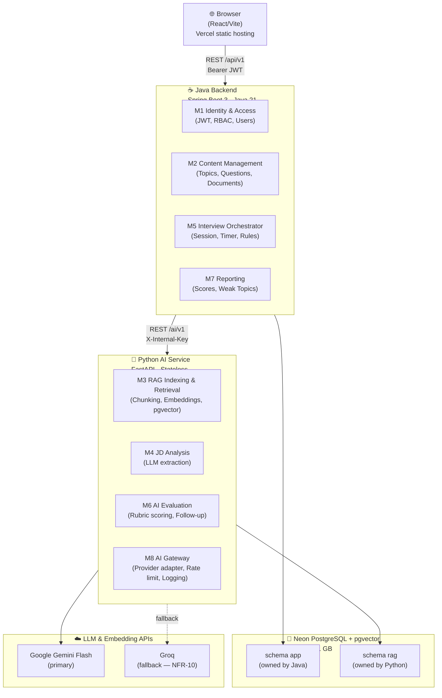

# Kiến trúc hệ thống — Tổng quan

> Cập nhật: 2026-10-16 · Task 01 (Monorepo setup)
> Nguồn gốc: SRS §10.1, design.md §1

---

## Sơ đồ tổng thể

---

## Nguyên tắc bất biến (architecture-guardrails.md)

| Quy tắc | Lý do |
|---|---|
| Frontend không gọi trực tiếp Python/LLM | Bảo mật; API key không bao giờ ở client |
| Java không tạo vector / gọi LLM | Tách trách nhiệm; Java chỉ orchestrate |
| Python không giữ trạng thái phiên | Stateless → scale dễ; state ở Java+DB |
| Điểm do Java tính (BR-01) | Không để LLM thay đổi điểm (NFR-20) |
| Không điểm/nhận xét khi phiên còn chạy | BR-20, AC-05, AC-12 |

---

## Thứ tự xây dựng (SRS §9.6)

| Lát cắt | Spec | Trạng thái |
|---|---|---|
| 1. Nền tảng nội dung | **01-foundation-content** (Task 01–08) | 🔄 Task 01 IN PROGRESS |
| 2. Từ JD đến phiên | 02-jd-to-session | ⏳ Pending |
| 3. Lõi phỏng vấn | 03-interview-core | ⏳ Pending |
| 4. Kết quả & học | 04-reporting | ⏳ Pending |

---

## Môi trường hosting (SRS §10.6)

| Thành phần | Dev | Production |
|---|---|---|
| Frontend | localhost:5173 (Vite) | Vercel (static) |
| Java Backend | localhost:8080 | Render free web service |
| Python AI Service | localhost:8000 | Koyeb free web service |
| Database | Neon dev branch | Neon main branch |
| LLM/Embedding | mock provider | Gemini Flash free tier |

> ⚠️ Giới hạn free tier cần kiểm tra lại khi deploy (SRS §1.4, open-questions.md A-04..A-07)
